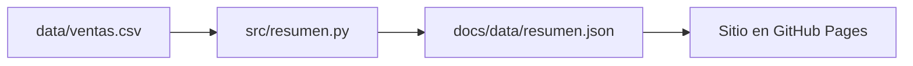

# Andina Market 360 · Tablero de ventas por sede

[](https://github.com/sarmientocamargojesus-bit/proyecto_andina_market/actions/workflows/ci.yml)
[](https://github.com/sarmientocamargojesus-bit/proyecto_andina_market/actions/workflows/pages.yml)

Resumen de ventas de una cadena **ficticia** de tiendas andinas, construido capítulo a capítulo con el cuaderno de prácticas Git y GitHub (36 capítulos). Todos los datos son inventados.

- **Sitio:** https://sarmientocamargojesus-bit.github.io/proyecto_andina_market/
- **Repositorio:** https://github.com/sarmientocamargojesus-bit/proyecto_andina_market

## Objetivo

Dar a la gerencia una vista única y verificable de las ventas de **Lima, Ica y Arequipa** con un flujo reproducible:



## Indicadores

| Indicador | Valor |
|---|---|
| Operaciones | 12 (4 por sede) |
| Total Lima | S/ 814.00 |
| Total Ica | S/ 555.00 |
| Total Arequipa | S/ 476.00 |
| **Total general** | **S/ 1845.00** |
| Ticket promedio | S/ 153.75 |
| Pruebas | 12 OK (9 del resumen + 3 de `ia_ticket`) |

## Requisitos

Python 3.11 o superior (solo biblioteca estándar) y Git.

## Inicio rápido

```bash
git clone https://github.com/sarmientocamargojesus-bit/proyecto_andina_market.git
cd proyecto_andina_market
python src/resumen.py                    # tablero en la terminal + docs/data/resumen.json
python -m unittest discover -s tests -v  # 12 pruebas
python scripts/humo.py                   # JSON publicado = CSV
bash scripts/cumplimiento.sh             # 6/6 controles
```

Ver el sitio en local: `python -m http.server 8000 -d docs` → http://localhost:8000

## Estructura

```
data/        ventas.csv (12 ventas ficticias) · diccionario.md
src/         resumen.py · ia_ticket.py
tests/       test_resumen.py · test_ia_ticket.py
scripts/     humo.py · cumplimiento.sh · escaneo_secretos.sh · verificar_enlaces.py · contraste.py · api/ · hooks/
docs/        index.html · productos.html · style.css · app.js · data/resumen.json
             manual.md · proyecto_final.md · guias/ · evidencias/registro.md
.devcontainer/  devcontainer.json
.github/     workflows/ · ISSUE_TEMPLATE/ · pull_request_template.md · CODEOWNERS · dependabot.yml
```

## Automatización (GitHub Actions)

| Workflow | Cuándo | Qué hace |
|---|---|---|
| `ci.yml` | push a `main` y PR | Pruebas, resumen, JSON al día, enlaces, cumplimiento; matriz Python 3.11/3.12 y artefacto |
| `pr.yml` | PR | Título con formato `tipo: descripción` |
| `pages.yml` | push a `main` | Publica `docs/` solo si las pruebas pasan; humo antes y después |
| `release.yml` | Release publicada | Adjunta ZIP (`git archive`), bundle y SHA-256 |
| `manual.yml` | botón *Run workflow* | Total y productos de una sede |
| `programado.yml` | lunes 08:00 (Lima) | Revisión semanal |
| `reutilizable.yml` / `usa-reutilizable.yml` | `workflow_call` | Pruebas y resumen reutilizables |

## Colaboración y seguridad

- Flujo: Issue → rama `feature/…`, `fix/…` o `docs/…` → Pull Request → revisión → Actions en verde → merge. Ver [CONTRIBUTING.md](CONTRIBUTING.md).
- Reglas de `main`: [docs/politica_main.md](docs/politica_main.md) · responsables: [.github/CODEOWNERS](.github/CODEOWNERS).
- Seguridad: [SECURITY.md](SECURITY.md) · [docs/seguridad.md](docs/seguridad.md) · [docs/dependencias.md](docs/dependencias.md).
- Auditoría y cumplimiento: [docs/auditoria.md](docs/auditoria.md) · fallos: [bitacora_fallos.md](bitacora_fallos.md).
- Uso de IA: [docs/politica_ia.md](docs/politica_ia.md).

## Documentación

| Documento | Contenido |
|---|---|
| [docs/manual.md](docs/manual.md) | Instalación, KPI y verificación |
| [docs/proyecto_final.md](docs/proyecto_final.md) | Alcance → evidencia y autoevaluación |
| [docs/evidencias/registro.md](docs/evidencias/registro.md) | Los 288 identificadores del cuaderno con su evidencia |
| [docs/portafolio.md](docs/portafolio.md) | Ficha del caso y guion de presentación |
| [CHANGELOG.md](CHANGELOG.md) | Versiones 1.0.0 y 2.0.0 |
| [docs/guias/](docs/guias/) | Cuenta, exploración, Desktop/VS Code, Projects, open source, release, 2FA/SSH, gh, Codespaces |

## Licencia

[MIT](LICENSE). Los datos son ficticios y no representan a ninguna empresa real.
