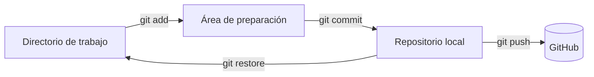

# Bitácora de trabajo

## Línea base de datos (capítulo 05)

| Dato | Valor |
|---|---|
| Registros en `data/ventas.csv` | 12 |
| Sedes | Lima, Ica, Arequipa (4 operaciones cada una) |
| Total Lima | S/ 814.00 |
| Total Ica | S/ 555.00 |
| Total Arequipa | S/ 476.00 |
| **Total general** | **S/ 1845.00** |

## Los tres espacios de Git

| Espacio | Qué contiene | Comando para ver su estado |
|---|---|---|
| Directorio de trabajo | Archivos que se editan | `git status` |
| Área de preparación (*staging*) | Cambios elegidos para el próximo commit | `git diff --staged` |
| Repositorio | Historial de commits | `git log --oneline` |

## Registro

| Fecha | Capítulo | Acción |
|---|---|---|
| 2026-11-17 | 05 | Línea base registrada |
| 2026-11-17 | 09 | Primer push y edición remota del README |
| 2026-11-17 | 09 | Push rechazado resuelto con fetch + merge |
| 2026-11-17 | 10 | Conflicto de título resuelto; revert de sede Cusco; stash y reflog |
