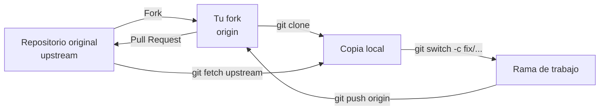

# Guía: contribuir a código abierto (capítulo 16)

> En este capítulo **no se abren Issues ni Pull Requests en proyectos ajenos**. Practicar en repositorios de otras personas genera notificaciones y trabajo de revisión reales para sus mantenedores. El ejercicio se documenta aquí y la práctica de fork se hace con repositorios de prueba (por ejemplo `octocat/Spoon-Knife`, creado para eso).

## 1. Antes de contribuir: leer las reglas

Ejemplo con `cli/cli` (GitHub CLI):

| Archivo | Qué revisar |
|---|---|
| `README.md` | Qué hace el proyecto y cómo instalarlo |
| `.github/CONTRIBUTING.md` | Qué tipo de contribuciones aceptan y cómo proponerlas |
| `.github/CODE_OF_CONDUCT.md` | Normas de convivencia |
| `LICENSE` | Condiciones de uso (MIT en `cli/cli`) |
| Issues con etiqueta `help wanted` / `good first issue` | Trabajo que los mantenedores **sí** quieren recibir |

Regla práctica: si el cambio no está pedido en un Issue, se pregunta primero en un Issue antes de escribir código.

## 2. Flujo fork → rama → Pull Request



```bash
git clone https://github.com/<tu-usuario>/Spoon-Knife.git
cd Spoon-Knife
git remote add upstream https://github.com/octocat/Spoon-Knife.git
git switch -c docs/mi-practica
# ... cambios y commits ...
git push -u origin docs/mi-practica
# Abrir el PR desde tu fork. Mantener el fork al día:
git fetch upstream && git merge upstream/main
```

## 3. Ética de la contribución

- No envíes PR generados automáticamente sin entenderlos y probarlos.
- Respeta el tiempo de los mantenedores: un cambio por PR, descripción clara y pruebas.
- Declara el uso de IA si el proyecto lo pide.
- Acepta un "no" con cortesía: el proyecto decide qué incorpora.
- Nunca publiques datos personales ni secretos en Issues, PR o comentarios.
