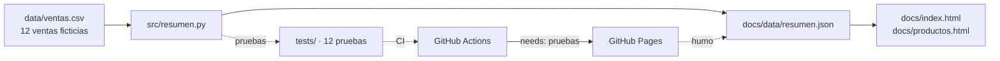

# Portafolio · Andina Market 360 (capítulo 35)

## Ficha del caso

| Campo | Contenido |
|---|---|
| Problema | La gerencia de una cadena ficticia no tenía una vista única de las ventas de Lima, Ica y Arequipa |
| Solución | Flujo reproducible **CSV → Python → JSON → página web**, versionado con Git y automatizado con GitHub Actions |
| Resultado | Total S/ 1845.00 · Lima 814.00 · Ica 555.00 · Arequipa 476.00 · ticket promedio 153.75 |
| Calidad | 12 pruebas `unittest`, CI en Python 3.11 y 3.12, humo antes y después de publicar, cumplimiento 6/6 |
| Colaboración | Issues, PR con revisión, plantillas, CODEOWNERS, regla de `main` |
| Seguridad | Escaneo de secretos, `.env` ignorado, Dependabot, `SECURITY.md` |
| Enlaces | [Repositorio](https://github.com/sarmientocamargojesus-bit/proyecto_andina_market) · [Sitio](https://sarmientocamargojesus-bit.github.io/proyecto_andina_market/) |

## Flujo

## Guion de presentación (3 minutos)

| Tiempo | Qué decir | Qué mostrar |
|---|---|---|
| 0:00–0:30 | El problema: tres sedes, sin vista única; datos ficticios | `proyecto.md` |
| 0:30–1:00 | La solución en un flujo: CSV → Python → JSON → página | Diagrama de arriba |
| 1:00–1:40 | Demostración: el sitio con el total S/ 1845.00 y el gráfico por sede | GitHub Pages |
| 1:40–2:20 | Cómo se trabaja: Issue → rama → PR → revisión → Actions en verde. Ejemplo real: PR #12 (rojo → verde) y PR #21 (error detenido antes de `main`) | Pestañas Pull requests y Actions |
| 2:20–2:45 | Seguridad y cumplimiento: secretos, Dependabot, 6/6 controles | `docs/auditoria.md` |
| 2:45–3:00 | Qué aprendí y siguiente paso | README del perfil |

## README de perfil

Plantilla lista para copiar: [plantilla_readme_perfil.md](plantilla_readme_perfil.md).
